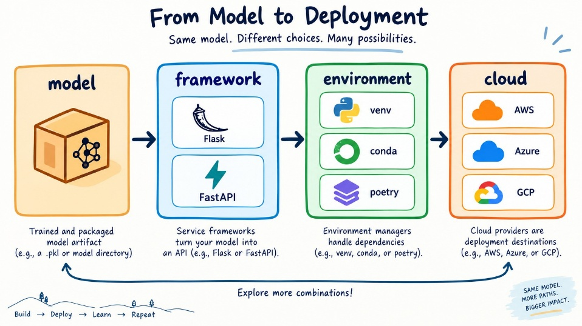
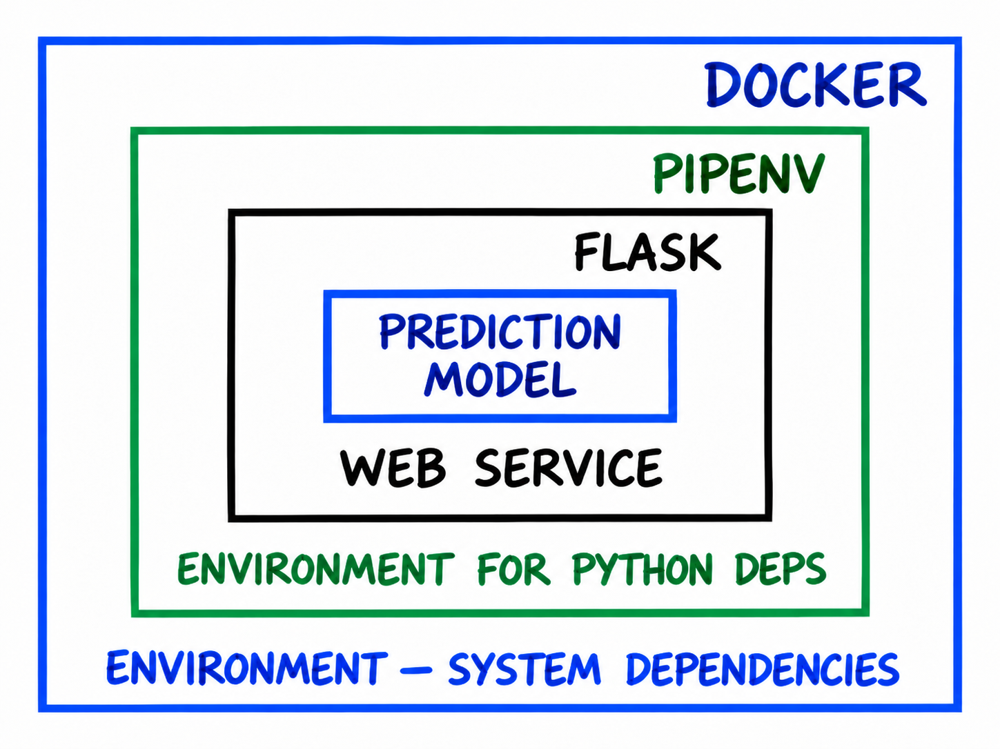
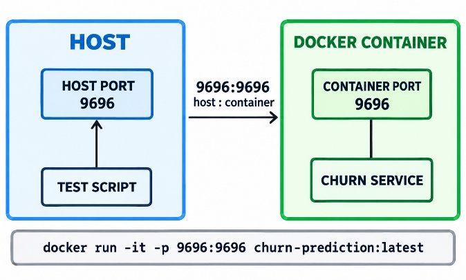

## Model Deployment Overview

Model deployment is the process of putting a trained Machine Learning Model into practical use so that it can make Predictions on new data without rerunning the Training code each time.

Once the Model has been deployed to a Server, we can create an Endpoint or API that lets other machines or applications connect, send data, and receive a Prediction in return.

Model deployment is important when a Model needs to be used by multiple machines or applications without requiring each system to contain its own Model Training code.

For example, a Marketing Service can send customer data to a Churn Prediction Service and receive the probability that the customer will churn. The Marketing Service can then use this Prediction in a business process, such as sending a promotional offer to a customer at high risk of churn.

### Main Steps in Model Deployment

1. **Train and Save the Model**

   After Training the Model, we save it to a file so that it can be loaded for future Predictions without retraining it each time.

2. **Create API Endpoints**

   Create an API Endpoint to receive data from other applications and return Predictions. Flask can be used as the framework for building the Web Service.

3. Additional Options for Deployment on a Server

    - Pipenv: Creates an isolated environment to manage the Web Service's Python dependencies and prevent its libraries or packages from interfering with other services on the same machine.

    - Docker: Packages the service in a Docker Container together with the required system and Python dependencies. This allows consistent deployment across different environments and reduces problems caused by differences between machines.

4. **Deploy to the Cloud**

   Deploy the Docker Container to a cloud platform such as AWS so that the Model Service is accessible beyond the local computer and other applications can call it over a network or the Internet.

Model deployment therefore turns a Machine Learning Model in a Notebook into a Web Service that other applications or systems can call to obtain Predictions in practice.

## pickle Saving and Loading the Model

In this chapter, we learn how to take a trained Machine Learning Model out of a Notebook and save it in a format that can be reused later, without retraining the Model whenever we need a Prediction.

### Why We Need to Save the Model

After Training, the Model and the objects used to prepare features exist only in the memory of the Notebook or Python process. Closing the Notebook or stopping the process causes these objects to be lost, so long-term Model use requires a way to store them outside memory. The main idea is to train the Model once and save the results so that they can be loaded for Predictions later. This clearly separates Model Training from Model use.

### Saving the Model with Pickle

pickle is a standard Python library used for serialization.

Serialization is the process of converting a Python object into a format that can be saved to a file and later loaded back as the original object.

For this Model, we save both the Logistic Regression Model and DictVectorizer. The vectorizer is part of data preparation before Prediction and has already learned the feature structure from the Training data. The saved objects should therefore include:

- Feature Transformation Object

- Trained Machine Learning Model

This ensures that future data preparation and Prediction follow the same steps used during Training.

### Binary File

Pickle stores objects as binary data.

Files used to save and load a Model must therefore be opened in binary mode. The key points to remember are:

- write-binary is used to save objects.

- read-binary is used to load objects.

The Model file can be named to reflect important information about the Model, such as a hyperparameter used during Training, to help manage multiple Model versions.

### Loading the Model

Once the Model has been saved, we can load the file and restore the saved objects. Loading restores the feature transformer and Model to a state ready for Prediction. The key point is that loading a Model does not train it again; it reuses a Model that has already been trained.

This allows a Web Service or application to start, load the Model, and provide Predictions without including a Training process within the service.

### Model and Feature Transformation Must Stay Together

A Machine Learning Model usually does not work directly with raw data. The data must first undergo feature transformation before being passed to the Model, so the transformation object and Model must be compatible.

If the feature transformation differs from the one used during Training, the input structure may not match what the Model learned, resulting in incorrect Predictions or a failure to run. The saved deployment artifact should therefore include both the preprocessing objects and the Model needed for Prediction.

### From Notebook to Python Script

Another important idea in this chapter is moving the Training process from a Notebook to a Python script. Notebooks are suitable for experimentation, data analysis, and Model development, but a Production workflow should run without manually opening a Notebook and executing cells. A Python script brings together the necessary steps, such as:

- Loading and preparing data

- Training the model

- Evaluating or validating the model

- Training the final model

- Saving the trained objects

A script makes the Training process more systematic and repeatable, and easier to use in automation or a Server environment.

### Separation of Training and Prediction

This chapter begins to clearly separate two processes:

- The Training process creates the Model and saves the results.

- The Prediction process loads an existing Model and applies it to new data.

This is a fundamental concept in Model deployment because a Production Service should not retrain a Model every time it receives a request.

### Security Consideration

Pickle files should only be loaded from trusted sources because they can contain Python objects that cause code to execute during loading. Do not use Pickle files from unknown or untrusted sources.

The central idea of saving and loading a Model is to train it once, save the trained objects, and load them for future Predictions without repeating Training.

## Flask Web Services

This section explains how one application can call another over a network, providing an important foundation before making a Machine Learning Model available to other systems.

### What is a Web Service?

A Web Service allows applications to communicate over HTTP. The main idea involves two sides:

- The Client sends a request.

- The Server receives the request, processes it, and returns a response.

The Client does not need to know how the Server works internally. It only needs to know:

- The address to send the request to.

- The method to use.

- The data to send.

- The format of the response it will receive.

This is an important concept in separating systems. In Machine Learning, for example, a Client does not need to know how a Model was trained or which algorithm it uses. It simply sends data to the Web Service and receives a Prediction.

### HTTP Methods

An HTTP method tells the Server what the Client wants to do with a resource or service. Common methods include:

- GET — Requests or retrieves data from the Server.

- POST — Sends data to the Server for processing.

- PUT — Sends data to create or update a resource at a specified location.

- DELETE — Requests deletion of a resource.

For Model deployment, we mainly focus on two methods:

- GET is used for simple Endpoints, such as a health check.

- POST is used to send feature data to the Model to request a Prediction.

### Endpoints and Routes

A Web Service often has a specific address called an Endpoint or route, such as /ping :78. This route has a specific purpose, such as checking whether the service is still running. This matters because a Web Service can have multiple Endpoints, each serving a different purpose. A Machine Learning Service might include:

- An Endpoint for health checks.

- An Endpoint for Prediction.

- An Endpoint for Model version information.

A route therefore connects a Client to a specific function on the Server.

### Why Flask?

Flask is a Python framework for creating small, straightforward Web Services. Flask lets us define:

- Which function handles each URL.

- Which HTTP methods can access a route.

- What response the Server should return.

Flask acts as an intermediary between network requests and our Python code. In the Prediction chapter, Flask will connect the Client to the Machine Learning Model.

### Ping/Pong Service

A ping/PONG service is a basic example used to check whether a Web Service is running.

When the Client sends a GET request to /ping, the Server responds with PONG. Although this is simple, it follows the same pattern as a real system:

Client sends a request → Server processes it → Server sends a response

The difference is that the Server currently returns plain text. In the next chapter, it will use a Machine Learning Model to make a Prediction before returning the response.

### localhost 0.0.0.0 and Ports

localhost or 127.0.0.1 refers to the machine currently running the service. A service bound only to localhost is generally accessible from that same machine. By contrast, 0.0.0.0 means the application listens for requests on all of the machine's network interfaces, which is suitable when it needs to receive external requests.

Another component is the port, which is the channel an application uses to accept connections, such as 9696. A service address therefore consists of Host + Port + Route, for example localhost:9696/ping.

### Development Server

Flask can run a Web Server directly for development. This server is suitable for learning, experimentation, and debugging, but is not suitable for Production. This highlights an important idea:

Building a Web Service and running it in Production are different tasks. Flask provides the application logic, while a Production Server helps the application handle real-world use more effectively.

A Web Service therefore acts as an intermediary that lets other applications call logic on the Server over HTTP without knowing the system's internal details. In Machine Learning, this is the step that turns a Model previously usable only in Python or a Notebook into a service that other systems can call through a Web Service.

## Flask Deployment

### Serving the model with Flask

We will serve the Machine Learning Model saved with pickle through Flask so that other applications can send data and receive Predictions over HTTP. The main idea is to turn a Model from a Python object used inside a program into a Prediction Service that other systems can call through an API.

When the Flask Service starts, it loads DictVectorizer and the trained Model from the previously saved file. The Model is loaded once at startup and reused for incoming requests, without loading or Training it again for each request.

Flask then creates a route such as /predict to accept POST requests from Clients. Data is sent in the request body as JSON, which Flask reads as a Python dictionary.

After receiving the data, DictVectorizer transforms it into a feature matrix with the same format used during Training. This is important because Prediction data must be prepared in the same way as Training data for the Model to work correctly.

Once the feature matrix is ready, the Model calculates a Prediction probability. A threshold can then convert this probability into a class decision.

Before returning the result, the Prediction value must be converted to a Python data type that can be serialized as JSON. Flask uses jsonify() to create the JSON response returned to the Client.

The main Prediction Service process is therefore:

1. Load Saved Model

2. Start Flask Application

3. Receive POST Request

4. Read JSON Data

5. Convert to Python Dictionary

6. Transform Features

7. Create Feature Matrix

8. Run Model Prediction

9. Get Probability

10. Apply Threshold

11. Create Prediction Result

12. Convert to JSON

13. Send Response to Client

An external application does not need to know how the Model was trained or which algorithm it uses. Knowing the input and output formats specified by the API is enough to call the service. This is the concept of an API contract between Client and Server.

### Testing the service

The Prediction Service uses POST requests because the Client must send data to the Server for the Model to process. It is therefore unsuitable for browser testing in the same way as a GET Endpoint. Testing uses a Client that can send a POST request with JSON data to /predict and receive a JSON response.

Check that the service accepts requests, reads JSON data correctly, transforms features in the same way as during Training, produces a Prediction, and returns the result as JSON. This verifies that the Client and Server communicate through the API as designed.

The main idea is:

Client sends data → Flask receives the request → Model processes it → Flask returns a Prediction

### Running in Production with Gunicorn

The Flask Development Server is suitable for development, experimentation, and debugging, but is not designed for a Production environment. For actual deployment, we use a WSGI Server, the standard for serving Python Web applications.

We can use Gunicorn on Linux/macOS and Waitress as an alternative on Windows. Gunicorn or Waitress receives network requests and forwards them to the Flask application for processing. Each component therefore has a clear responsibility:

- Flask handles routes, requests, responses, and Prediction logic.

- Gunicorn / Waitress handles running the Web application in Production and receiving network requests.

This separation makes the service more suitable for real-world use than running it directly through the Flask Development Server.

Flask therefore turns a Machine Learning Model into a Web Service that receives data from other applications over HTTP and returns Predictions as JSON. Gunicorn or Waitress helps prepare the service for Production use.

## Pipenv Python Virtual Environment

Manage project dependencies in a virtual environment isolated from system Python so that the Web Service uses the library versions we tested and the same environment can be recreated on other machines.

### The Problem: Conflicting Library Versions

When we use pip install in the usual way, packages are installed into a shared Python environment. Problems arise when projects need different versions of the same library. For example, an older project may require one scikit-learn version while a new project needs a newer version. Upgrading the library for one project may cause errors or prevent another project from running. A virtual environment solves this problem.

A virtual environment is an isolated environment for each project. Each project can have its own Python packages and library versions without affecting other projects or system Python.

The main idea is that each project should have its own environment to prevent dependency conflicts and improve stability. Other tools include venv, conda, and poetry, but this lesson uses Pipenv because it both creates a virtual environment and records the package versions used by the project.

### Installing Libraries with Pipenv

Pipenv creates an environment and installs the project's dependencies into it. Using Pipenv creates two important files in the project:

- Pipfile — Specifies the packages the project requires and can specify the desired versions.

- Pipfile.lock — Records the exact installed versions of all packages, including their dependencies.

The key distinction is that Pipfile describes the project's requirements, while Pipfile.lock specifies an exact environment that can be reproduced.

Pipenv therefore supports both library installation and reproducibility. An environment that works on our machine can be recreated on a Server or another machine using the same package versions.

This helps reduce the problem commonly called “Works on my machine,” because the Server can install an environment matching the versions we tested.

### Running Things with Pipenv

With Pipfile and Pipfile.lock, another machine can recreate the same environment. We can then run Python, Flask, or Gunicorn within that virtual environment. The key point is that every command run inside the environment uses the project's packages rather than those from system Python.

Each service can therefore have its own dependencies without conflicting with other services on the same machine.

### Why Pipenv Matters for Deployment

During deployment, we want the Production environment to match the environment used to develop and test the Model as closely as possible. Pipenv helps control:

1. Python Dependencies

2. Library Versions

3. Isolation between projects

4. Environment reproducibility

However, Pipenv manages only the Python environment. Other aspects, such as the Python runtime, operating system, and system dependencies, still depend on the machine running the service. Docker is therefore needed to manage the environment at a broader level.

The central idea of Pipenv Python Virtual Environment is that Pipenv isolates each project's dependencies and records package versions so that the same environment can be recreated on another machine.

## Docker Environment Management

Package the Prediction Service in a Docker Container so that it runs in the same environment regardless of the machine. The main goal is to avoid depending directly on the host machine's environment.

### Why Docker

Pipenv isolates a project's Python dependencies, but other parts of the environment still depend on the machine running it, such as:

- Python Version

- Operating System

- System Libraries

- System Dependencies

Even with matching Python packages, a service may behave differently if host environments differ. Docker addresses this by packaging the application and its required environment in a Docker Image. An Image can include:

- Operating System Layer

- Python Runtime

- System Dependencies

- Python Dependencies

- Application Code

- Model File

A Container created from an Image runs in the defined environment on any machine that supports Docker. The key idea is that Pipenv isolates the Python environment, while Docker isolates a broader environment, including Python and system dependencies.

### Docker Image and Docker Container

Docker has two important concepts to distinguish:

- A Docker Image is a package or template specifying what an application needs. The Image is what we build.

- A Docker Container is an instance created and running from a Docker Image. The Container is what we run.

### The Dockerfile

A Docker Image is built from a Dockerfile, which acts as a recipe defining how the environment inside the Image is created. A Dockerfile specifies main steps such as:

- Select a base image and Python version.

- Install Pipenv.

- Set the working directory.

- Copy Pipfile and Pipfile.lock.

- Install dependencies.

- Copy the application code and Model file.

- Specify the port used by the service.

- Set the command to run when the Container starts.

The key point is that the Dockerfile defines the environment as code, allowing the same environment to be built repeatedly.

### Pipenv Inside Docker

Inside Docker, we use Pipenv to install dependencies according to Pipfile.lock. There is no need to create another virtual environment because the Docker Container is already isolated. Dependencies are installed directly into the Container's Python environment, reducing environment complexity.

### Running the Application

Once the Docker Image is built, we can create and run a Container from it. The Container starts the Flask application through a Production Server such as Gunicorn, using the command specified in ENTRYPOINT. When the Container starts, its application environment is already prepared and the service can immediately begin accepting requests.

### Port Mapping

A Docker Container's network is isolated from the host machine. Even if the service inside the Container opens a port such as 9696, the host cannot access it directly until port mapping is configured. The idea is:

- The host port receives external requests.

- The Container port is the port on which the application inside the Container listens.

Once the ports are mapped, requests reaching the host are forwarded to the service inside the Container. Port mapping therefore bridges the host network and the Container network.

### Building and Running

The main process has two steps:

1. **Build Image**

   Docker reads the Dockerfile and creates an Image containing the specified environment, dependencies, code, and Model.

2. **Run Container**

   Docker creates a Container from the Image and starts the application inside it.

The Client can then send requests to the service through the mapped port, just as when the service runs on a local machine.

### Complete Isolation

An important benefit of Docker is that each Container can have its own environment. Different services can therefore use:

- Different operating system versions

- Different Python versions

- Different system libraries

- Different Python dependencies

They can do so without interfering with one another, even on the same host machine. This provides greater isolation than Pipenv, which focuses on Python packages, while Docker covers the application's overall environment.

Docker packages an application with its required environment and dependencies so that the service runs consistently across machines that support Docker.

## AWS Deployment to the Cloud

We can deploy the Prediction Service's Docker Image on AWS Elastic Beanstalk so that other applications or machines can access it over the Internet.

### Why the Cloud

Our service currently runs only on a local machine, meaning other applications can use it only if they can access our machine. Cloud deployment allows the Model Service to run on an Internet-connected Server and be called by other systems at any time.

AWS is a cloud provider offering virtual machines and infrastructure for running applications. Elastic Beanstalk (EB) simplifies deployment: we upload an application or Docker Container, and AWS manages the required infrastructure.

We can therefore hand the Docker Container, with its environment and application already prepared, to the cloud platform to run and manage the service.

### Architecture Overview

The Machine Learning Prediction Service is packaged in a Docker Container and deployed on Elastic Beanstalk. When an external application sends a request, Elastic Beanstalk receives it and forwards it to the Docker Container running the Flask Service.

After the Model processes the Prediction, the response returns through Elastic Beanstalk to the Client. The cloud therefore provides an environment that makes the Web Service available beyond the local machine.

### Scalability with Elastic Beanstalk

A major benefit of Elastic Beanstalk is its support for scaling. As requests increase, the system can add instances to handle the higher load. When traffic decreases, it can reduce the number of instances. This is called horizontal scaling: increasing or decreasing the number of machines or application instances according to usage.

Elastic Beanstalk therefore supports both application deployment and management of the service's infrastructure and capacity.

### Deploying Step by Step

The main deployment steps are:

1. Install the AWS Elastic Beanstalk CLI: Install the tool for creating and managing Elastic Beanstalk environments from the local machine. The EB CLI is a development dependency and does not need to be included in the Docker Container.

2. Initialize the Elastic Beanstalk Application: Specify the platform, such as Docker, the AWS Region, and the application name, and create the project's configuration.

3. Verify the Configuration: Review the configuration created by Elastic Beanstalk to ensure the platform and environment settings are correct.

4. Test Locally: Test the application in the Elastic Beanstalk local environment before deployment to ensure the Docker Image and Web Service work correctly.

5. Create and Deploy the Cloud Environment: Elastic Beanstalk creates an environment on AWS, runs the Docker Container, and makes the application available.

6. Access the Service: After successful deployment, Elastic Beanstalk creates an Endpoint URL for the service so that Clients can send requests over the Internet.

### Public Endpoint and Security

After cloud deployment, the Endpoint may be accessible from the Internet. A Production Service should therefore have security controls such as:

- Authentication

- Authorization

- Network Access Control

- HTTPS

- Restricting which Clients can call the API

This matters because the Model Service should not be available to the general public without access controls.

### Terminating the Environment

Cloud resources incur costs while they are running. When an environment is no longer needed, terminate it to stop the resources and avoid unnecessary costs.

For cloud deployment, AWS Elastic Beanstalk allows a Dockerized Machine Learning Service to move from a local machine to the cloud and become accessible to other applications over the Internet. AWS manages infrastructure, deployment, and scaling.

In the Model Deployment module, we started with a Model in a Notebook and gradually turned it into a Web Service that other systems can call.

### Overall Deployment Process

We started with a Model usable only within a Notebook and gradually reduced its dependence on our local machine through the following steps:

- **Saving and Loading the Model**

  Use pickle to save and load the Model so that it can be reused without retraining each time, and move code from the Notebook to a Python script.

- **Web Services with Flask**

  Learn how applications communicate over HTTP, and use Flask to turn the Model into a Web Service with a /predict Endpoint that accepts JSON data and returns a Prediction.

- **Production Server**

  Replace the Flask Development Server with Gunicorn for Production, using Waitress as an alternative on Windows.

- **Dependency and Environment Management with Pipenv**

  Use Pipenv to create a virtual environment isolated from other projects and keep library versions consistent with the tested environment.

- **Environment Management with Docker**

  Use Docker to package the application, Python, and required dependencies in a Docker Image so that the service runs consistently across machines.

- **Deployment to the Cloud**

  Use AWS Elastic Beanstalk to run the Docker Container in the cloud and make the Model Service externally accessible over the Internet.

We turned a Machine Learning Model in a Notebook into a service that other applications can call, separating Training from Prediction and preparing an environment that runs consistently in Production.

