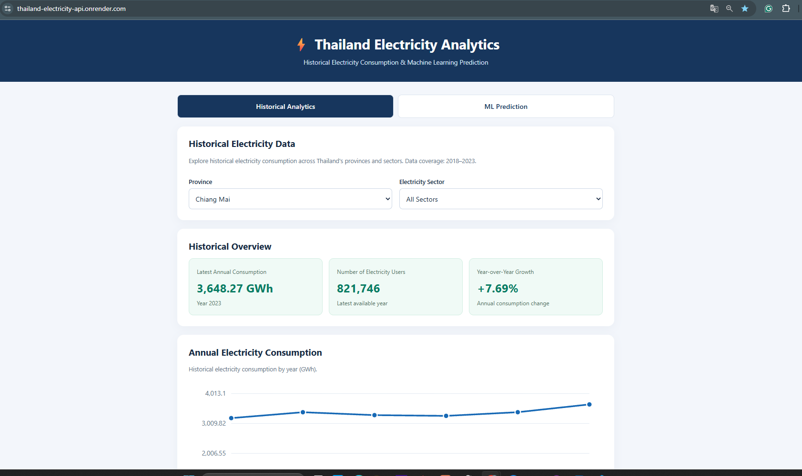
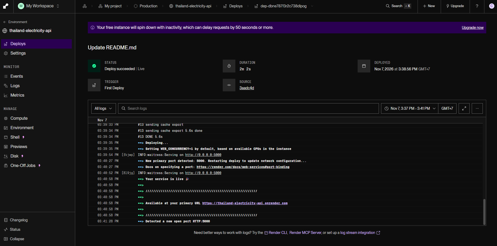

# Thailand Electricity Consumption Prediction
### Machine Learning (Linear Regression/Random Forest) | Flask REST API | Docker | Render Cloud | Web Application

An end-to-end Machine Learning project that predicts annual electricity consumption across five major electricity sectors in Thailand using historical provincial electricity data.

The project covers the complete Machine Learning workflow, including data preparation, exploratory data analysis, feature engineering, model training, evaluation, model serialization, REST API development, containerization, and cloud deployment.

The trained model is deployed as a **live Web Application** using Flask, Docker, and Render Cloud, allowing users to generate electricity consumption predictions directly from their browser.

## 🌐 Live Web Application

**[Launch Thailand Electricity Prediction](https://thailand-electricity-api.onrender.com/)**

### Web Application Preview



Users can interact with the trained Machine Learning model through a web interface without installing Python or running the model locally.

The application allows users to:

- Select a province in Thailand.
- Choose one of five electricity sectors.
- Enter the number of electricity users.
- Generate an annual electricity consumption prediction.
- View the predicted consumption in kWh/year.

The application uses a Flask backend to process prediction requests, apply the same feature transformations used during training, and return predictions generated by the trained Random Forest model.

**Live Application:** https://thailand-electricity-api.onrender.com/

**API Health Check:** https://thailand-electricity-api.onrender.com/ping

**Available Provinces and Sectors:** https://thailand-electricity-api.onrender.com/options

> **Cloud hosting note:** This application runs on Render's free service tier. The service may become inactive after a period of inactivity, and the first request may take additional time while the application starts.



---

## 1. Project Overview

Electricity consumption is an important indicator of economic activity, infrastructure development, and energy demand.

This project explores how electricity consumption varies across Thailand's provinces and electricity sectors, and whether historical electricity consumption patterns can be used to train a Machine Learning model for predicting annual consumption.

The project focuses on a supervised regression problem.

**Prediction target:**

`electricity_kwh` — annual electricity consumption measured in kilowatt-hours.

**Input features:**

- `province_en` — Province in Thailand.
- `sector` — Electricity consumption sector.
- `number_of_users` — Number of electricity users.

The model learns relationships between these features and historical electricity consumption.

The final application allows users to provide these three inputs and receive a prediction.

## 2. Dataset

The project uses historical provincial electricity consumption data for Thailand.

| Dataset Property | Description |
|---|---|
| Geographic coverage | 77 provinces |
| Time period | 2018–2023 |
| Electricity sectors | 5 major sectors |
| Total observations | 2,310 |
| Target variable | Annual electricity consumption (kWh) |
| Prediction type | Regression |

Each observation represents a combination of province, year, and electricity sector.

### Electricity Sectors

The dataset includes five electricity sectors:

| Sector | Model Value |
|---|---|
| Residential | `residential` |
| Small Business | `small_business` |
| Medium Business | `medium_business` |
| Large Business | `large_business` |
| Specific Business | `specific_business` |

These sectors represent different categories of electricity users and consumption patterns.

### Dataset Structure

The analytical dataset includes the following main variables:

| Variable | Type | Description |
|---|---|---|
| `province_en` | Categorical | Province name in English |
| `year` | Integer | Year of observation |
| `sector` | Categorical | Electricity sector |
| `number_of_users` | Numerical | Number of electricity users |
| `electricity_kwh` | Numerical | Annual electricity consumption |

The year variable supports the historical analysis and time-based validation. The deployed prediction interface requires province, sector, and number of users.

---

## 3. Machine Learning Workflow

The project follows a structured Machine Learning workflow:

**Data Collection → Data Preparation → Exploratory Data Analysis → Feature Engineering → Model Training → Model Evaluation → Model Selection → Model Serialization → Flask API → Docker → Cloud Deployment → Web Application**

### 3.1 Data Preparation

The data preparation process includes organizing electricity consumption and electricity user information into a consistent analytical dataset.

The preparation focuses on:

- Structuring records by province, year, and electricity sector.
- Preparing numerical and categorical features.
- Checking missing or inconsistent values.
- Preparing the target variable.
- Creating training, validation, and test datasets.

### 3.2 Exploratory Data Analysis

Exploratory Data Analysis is used to understand electricity consumption patterns across provinces and electricity sectors.

The analysis examines:

- Distribution of electricity consumption.
- Differences between electricity sectors.
- Variation in electricity consumption across provinces.
- Relationships between the number of electricity users and electricity consumption.
- Potential outliers and differences in consumption scale.

### 3.3 Feature Engineering

The model uses categorical and numerical features.

Categorical features are transformed using One-Hot Encoding:

- `province_en`
- `sector`

The numerical input is:

- `number_of_users`

Additional sector-specific interaction features are created to represent the number of electricity users within each electricity sector.

These interaction features allow the model to distinguish between the relationships of electricity users and electricity consumption across different sectors.

### 3.4 Training, Validation, and Test Sets

The dataset is divided chronologically to evaluate the model on later observations.

| Dataset | Year(s) | Observations |
|---|---|---:|
| Training | 2018–2021 | 1,540 |
| Validation | 2022 | 385 |
| Test | 2023 | 385 |

This approach evaluates how effectively the model generalizes to data from a later year.

The validation dataset is used for model comparison and tuning, while the test dataset is reserved for final evaluation.

---

## 4. Machine Learning Models

Three regression algorithms were explored:

### Linear Regression

Linear Regression is used as a baseline model to estimate electricity consumption through linear relationships between input features and the target variable.

### Ridge Regression

Ridge Regression extends Linear Regression by introducing L2 regularization to control coefficient magnitude and reduce sensitivity to correlated features.

### Random Forest Regression

Random Forest combines multiple decision trees and aggregates their predictions.

It can capture nonlinear relationships and interactions between electricity sectors, provincial characteristics, and the number of electricity users.

### Final Model Selection

**Random Forest Regression** was selected as the final deployed model based on its validation performance.

The selected model was subsequently saved for use in the prediction API and web application.

---

## 5. Model Evaluation

The model evaluation uses three regression metrics.

| Metric | Description |
|---|---|
| Mean Absolute Error (MAE) | Average absolute difference between actual and predicted electricity consumption |
| Root Mean Squared Error (RMSE) | Square root of average squared prediction errors |
| R² Score | Proportion of variation in electricity consumption explained by the model |

### Selected Random Forest — Validation Results

| Metric | Result |
|---|---:|
| MAE | 38,146,902.46 kWh |
| RMSE | 113,160,100.36 kWh |
| R² Score | 0.9907 |

These values are from the training script's validation evaluation.

The high R² score indicates that the model explains a substantial proportion of variation in the validation dataset. However, performance may vary across provinces, sectors, and input ranges.

The final deployed model is intended for estimating electricity consumption patterns, rather than providing official forecasts.

**Note:** Results generated by the training script may differ slightly from earlier notebook experiments due to implementation and preprocessing details.

---

## 6. Model Serialization

After model training and evaluation, the trained model and preprocessing information are saved in a binary artifact.

**File:** `model.bin`

The serialized artifact contains the information required to reconstruct the prediction pipeline, including:

- Trained Machine Learning model.
- Fitted categorical encoder.
- Feature names and their order.
- Selected electricity sectors.

This allows the prediction service to load the trained model without retraining whenever the application starts.

The Flask API reads `model.bin` during application initialization.

---

## 7. Flask REST API

The Machine Learning model is served through a Flask REST API.

Flask receives prediction requests, validates input data, performs feature transformations, generates predictions, and returns JSON responses.

### API Endpoints

| Method | Endpoint | Description |
|---|---|---|
| GET | `/` | Displays the Web Application |
| GET | `/ping` | Checks API health |
| GET | `/options` | Returns available provinces and electricity sectors |
| POST | `/predict` | Generates an electricity consumption prediction |

### Health Check

**Endpoint:**

`GET /ping`

Example response:

```json
{
  "message": "PONG"
}
```

### Available Provinces and Sectors

**Endpoint:**

`GET /options`

This endpoint retrieves province names directly from the fitted encoder and returns the sectors supported by the model.

The Web Application uses this endpoint to populate the Province Dropdown dynamically.

This avoids maintaining a separate hardcoded province list within the HTML.

### Electricity Consumption Prediction

**Endpoint:**

`POST /predict`

**Request format:**

```json
{
  "province_en": "Chiang Mai",
  "sector": "residential",
  "number_of_users": 500000
}
```

**Example response:**

```json
{
  "province_en": "Chiang Mai",
  "sector": "residential",
  "number_of_users": 500000,
  "predicted_electricity_kwh": 1240984762.18
}
```

Prediction results depend on the deployed model and the provided input values.

### Testing the Cloud API

The API can be tested through PowerShell:

```powershell
$body = @{
    province_en = "Chiang Mai"
    sector = "residential"
    number_of_users = 500000
} | ConvertTo-Json

Invoke-RestMethod `
    -Uri "https://thailand-electricity-api.onrender.com/predict" `
    -Method POST `
    -ContentType "application/json" `
    -Body $body
```

The API can also be accessed by other applications capable of sending HTTP requests.

---

## 8. Web Application Development

The project includes a browser-based interface developed using:

- HTML — Page structure and input forms.
- CSS — Responsive layout, styling, and visual presentation.
- JavaScript — User interaction, API requests, and result rendering.
- Flask — Backend API and delivery of the web interface.

**Frontend file:** `web/index.html`

### Application Features

The Web Application contains two main components.

**Prediction Inputs**

Users provide:

1. Province.
2. Electricity sector.
3. Number of electricity users.

**Prediction Result**

The application displays:

- Estimated annual electricity consumption.
- Province.
- Electricity sector.
- Number of users.

### Frontend and Backend Integration

The web interface communicates with the Flask API through JavaScript's `fetch()` function.

When the page loads:

1. The browser requests the Web Application from Flask.
2. JavaScript calls `GET /options`.
3. Flask returns the provinces and sectors supported by the trained model.
4. The browser populates the Province Dropdown.

When the user selects the inputs and clicks **Predict Electricity Consumption**:

1. JavaScript collects the form inputs.
2. The browser sends a JSON request to `POST /predict`.
3. Flask validates the inputs.
4. The trained model generates a prediction.
5. Flask returns the result as JSON.
6. JavaScript displays the prediction in kWh/year.

The frontend and backend are hosted together within the same application, allowing the website to use relative API paths such as `/predict`.

---

## 9. Docker Containerization

Docker is used to package the Machine Learning application into a container.

Containerization provides a consistent deployment environment containing the application, trained model, Python dependencies, and web interface.

### Dockerfile

```dockerfile
# Use Python 3.11
FROM python:3.11-slim

# Set working directory
WORKDIR /app

# Install Pipenv
RUN pip install --no-cache-dir pipenv

# Copy dependency files
COPY Pipfile Pipfile.lock ./

# Install dependencies inside the container
RUN pipenv sync --system

# Copy application and trained model
COPY predict.py model.bin ./

# Copy Web Interface
COPY web/ ./web/

# Expose API port
EXPOSE 5000

# Run Flask API using Waitress
CMD ["waitress-serve", "--host=0.0.0.0", "--port=5000", "predict:app"]
```

The Docker image includes the Flask API, model artifact, and HTML web interface.

**Waitress** is used as the production WSGI server.

It serves the Flask application on port `5000` and listens on `0.0.0.0` to accept requests through the container's network interface.

### Build Docker Image

From the project directory:

```bash
docker build -t thailand-electricity-api .
```

### Run Docker Container

```bash
docker run --rm -p 5001:5000 thailand-electricity-api
```

The application is then available locally at:

`http://localhost:5001/`

The port mapping connects port `5001` on the host machine to port `5000` inside the container.

### Docker Verification

Test the container by opening:

- `http://localhost:5001/`
- `http://localhost:5001/ping`
- `http://localhost:5001/options`

The prediction form can then be used to verify the complete frontend-to-backend workflow.

---

## 10. Cloud Deployment — Render

The final Machine Learning application is deployed to **Render Cloud** using a Docker-based Web Service.

**Production URL:**

https://thailand-electricity-api.onrender.com/

### Cloud Deployment Architecture

```text
                GitHub Repository
                        |
                        v
                   Render Cloud
                        |
                        v
                 Docker Build
                        |
                        v
              Docker Container
                        |
           +------------+------------+
           |                         |
           v                         v
     Web Interface               Flask API
     HTML / CSS / JS            /ping
                                /options
                                /predict
           |                         |
           +------------+------------+
                        |
                        v
                Trained ML Model
                    model.bin
                        |
                        v
             Electricity Prediction
                    (kWh/year)
```

### Render Deployment Configuration

The application is deployed with the following configuration:

| Setting | Configuration |
|---|---|
| Platform | Render |
| Service Type | Web Service |
| Runtime | Docker |
| Repository | Machine-Learning-Zoom-Camp |
| Branch | `main` |
| Root Directory | `07-midterm-project` |
| Dockerfile Path | `Dockerfile` |
| Application Port | `5000` |
| Web Server | Waitress |
| Service Plan | Free |

### Cloud Deployment Process

**Step 1 — Prepare the Repository**

The project contains the training script, prediction service, model artifact, dependency files, Dockerfile, and web interface.

**Step 2 — Push to GitHub**

Project changes are committed and pushed to the `main` branch.

**Step 3 — Create a Render Web Service**

A Render Web Service is connected to the GitHub repository.

**Step 4 — Configure Docker Deployment**

Render uses the Dockerfile within `07-midterm-project` to build the application image.

**Step 5 — Build the Container**

Docker installs the Python dependencies and copies the prediction service, trained model, and web interface into the image.

**Step 6 — Start the Production Server**

Render starts the container with Waitress:

```bash
waitress-serve --host=0.0.0.0 --port=5000 predict:app
```

**Step 7 — Access the Application**

After a successful deployment, the application is available through the public Render URL.

### Continuous Deployment

The application is connected to GitHub with automatic deployment enabled.

When new changes are pushed to the configured branch, Render can automatically rebuild and redeploy the application.

This workflow supports updates to:

- Flask API functionality.
- Web Application interface.
- Docker configuration.
- Trained model artifacts.

Changes to the trained model require the updated model artifact and compatible prediction code to be included in the deployment.

### Deployment Verification

After deployment, the following components should be tested:

| Test | Expected Result |
|---|---|
| Open `/` | Web Application loads |
| Open `/ping` | API returns PONG |
| Open `/options` | Province and sector options are returned |
| Submit valid prediction | API returns predicted consumption |
| Use Province Dropdown | Available provinces are displayed |
| Submit invalid input | API returns an appropriate error |

---

## 11. Running the Project Locally

### Requirements

- Python 3.11
- Pipenv
- Git
- Docker (optional for local container testing)

### Clone the Repository

```bash
git clone https://github.com/ChalermponBoontanapracop/Machine-Learning-Zoom-Camp.git
```

Navigate to the project directory:

```bash
cd Machine-Learning-Zoom-Camp/07-midterm-project
```

### Install Dependencies

```bash
pipenv sync
```

### Start the Flask Application

```bash
pipenv run python predict.py
```

The application is configured to run locally at:

`http://127.0.0.1:5000/`

If port `5000` is already in use, start the application on an alternative port:

```bash
pipenv run python -c "from predict import app; app.run(host='127.0.0.1', port=5002)"
```

Then open:

`http://127.0.0.1:5002/`

### Test the Prediction API

```bash
pipenv run python test.py
```

The test script can be used to verify the API responses and prediction behavior.

### Retrain the Model

```bash
pipenv run python train.py
```

The training script requires the original training data to be available at the paths expected by the project.

Retraining may update `model.bin`, which can subsequently be used for local or cloud predictions.

---

## 12. Project Structure

```text
07-midterm-project/
|
|-- raw data/
|   |-- Historical electricity datasets
|
|-- web/
|   |-- index.html
|
|-- notebook.ipynb
|-- train.py
|-- predict.py
|-- test.py
|-- model.bin
|
|-- Pipfile
|-- Pipfile.lock
|-- Dockerfile
|-- .dockerignore
|-- .gitignore
|
|-- README.md
```

### Main Files

| File | Description |
|---|---|
| `notebook.ipynb` | Data analysis, feature engineering, model development, and evaluation |
| `train.py` | Model training and serialization |
| `predict.py` | Flask API and web interface routes |
| `test.py` | API testing |
| `model.bin` | Serialized trained model and preprocessing artifacts |
| `web/index.html` | Web Application frontend |
| `Dockerfile` | Docker image configuration |
| `Pipfile` | Project dependency definitions |
| `Pipfile.lock` | Locked dependency versions |
| `README.md` | Project documentation |

---

## 13. Technologies Used

| Category | Tools and Technologies |
|---|---|
| Programming | Python |
| Data Processing | pandas, NumPy |
| Machine Learning | scikit-learn |
| Model Serialization | pickle |
| Backend Development | Flask |
| Frontend Development | HTML, CSS, JavaScript |
| Production Server | Waitress |
| Dependency Management | Pipenv |
| Containerization | Docker |
| Version Control | Git, GitHub |
| Cloud Deployment | Render |
| Development Environment | VS Code, Jupyter Notebook |

---

## 14. Limitations

Although the model performs well on the validation dataset, several limitations should be considered.

### Historical Data Coverage

The model was developed using historical electricity consumption data from 2018–2023. It does not directly incorporate more recent changes in electricity demand.

### Limited Input Features

The deployed model uses province, electricity sector, and number of electricity users.

Other factors may influence electricity consumption, including:

- Weather and temperature.
- Economic activity.
- Industrial production.
- Household characteristics.
- Energy efficiency.
- Electricity pricing.
- Changes in technology and infrastructure.

### Predictions Outside the Training Distribution

The application accepts user-entered numbers of electricity users.

Inputs that are substantially different from historical observations may produce unreliable estimates.

For example, entering a very large number of users in a sector where historical user counts are much smaller may lead to predictions outside realistic operating conditions.

### Not a Time-Series Forecasting System

The deployed model estimates electricity consumption based on the supplied province, sector, and user count.

It does not directly predict electricity consumption for a user-selected future year.

The prediction should therefore be interpreted as a model-based consumption estimate rather than a formal forecast of future electricity demand.

### Model Performance

Evaluation metrics summarize performance across observations and do not guarantee equal accuracy for every province or electricity sector.

---

## 15. Future Improvements

Potential future developments include:

**Data and Model Development**

- Incorporate additional years of electricity consumption data.
- Integrate temperature and weather information.
- Add provincial demographic and economic indicators.
- Explore Gradient Boosting and other regression algorithms.
- Evaluate model performance separately across provinces and electricity sectors.
- Develop time-series forecasting models.

**Web Application Development**

- Display model performance metrics on the website.
- Add charts comparing estimated electricity consumption across sectors.
- Provide historical electricity consumption visualizations.
- Add explanations of model inputs and limitations.
- Display warnings when inputs are outside typical historical ranges.
- Improve the mobile user experience.

**Cloud and API Development**

- Add automated deployment tests.
- Introduce model and API versioning.
- Improve application monitoring and logging.
- Add stronger input validation.
- Support batch predictions and downloadable results.
- Evaluate hosting options for higher availability.

---

## 16. Key Learning Outcomes

This project demonstrates the application of Machine Learning beyond model training in a Jupyter Notebook.

The main learning outcomes include:

1. Preparing structured data for a supervised regression problem.
2. Engineering numerical, categorical, and interaction features.
3. Comparing multiple Machine Learning algorithms.
4. Using chronological validation for model evaluation.
5. Saving a trained Machine Learning model for reuse.
6. Developing a prediction service using Flask.
7. Connecting a browser-based frontend to a REST API.
8. Packaging a Python application using Docker.
9. Deploying a containerized application to Render Cloud.
10. Maintaining application changes through GitHub and automatic deployment.

The project provides practical experience in developing, testing, deploying, and using a Machine Learning application in a cloud environment.

---

## 17. Repository and Application

**GitHub Repository**

https://github.com/ChalermponBoontanapracop/Machine-Learning-Zoom-Camp

**Project Folder**

https://github.com/ChalermponBoontanapracop/Machine-Learning-Zoom-Camp/tree/main/07-midterm-project

**Live Web Application**

https://thailand-electricity-api.onrender.com/

---

## Disclaimer

This project was developed for educational purposes as part of the Machine Learning Zoomcamp learning journey.

Predictions are generated using historical data and a trained Machine Learning model. They should not be treated as official electricity consumption statistics, regulatory estimates, or authoritative energy demand forecasts.

The accuracy of individual predictions depends on the quality and representativeness of the training data and the input values provided.
